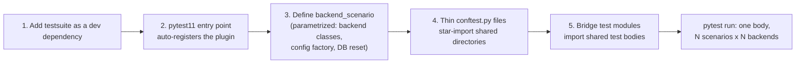
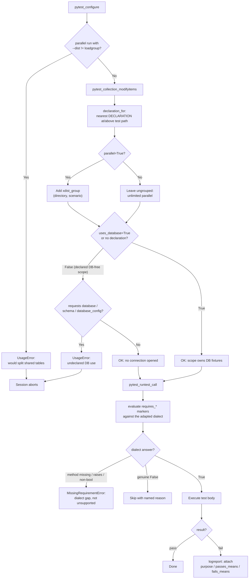

# The shared suite's pytest plugin

> Status (2026-11-18): **mature enough to adopt**. The backend wiring and the
> minimum-parallel-unit rules below are stable; this document is the detailed
> reference. The top-level README has the short version.

The plugin installs itself through the package's `pytest11` entry point. A
backend only has to depend on `rhosocial-activerecord-testsuite`; no `-p` flag
and no provider interfaces are involved. It owns three things: **which tests a
backend contributes**, **which unit may run in parallel**, and **what a dialect
must answer**. It owns no tables, fixtures or environment of its own — those
belong to each test directory's `conftest.py`.

## 1. How a backend plugs in

A backend contributes a test tree with three thin layers. There is one copy of
every test body; backends never fork assertions.



```text
<backend>/tests/conftest.py
    backend_scenario(request)          # parametrized fixture: the backend's scenarios

<backend>/tests/.../feature/basic/conftest.py
    from rhosocial.activerecord.testsuite.feature.basic.conftest import *

<backend>/tests/.../feature/basic/<group>/conftest.py
    from rhosocial.activerecord.testsuite.feature.basic.<group>.conftest import *

<backend>/tests/.../feature/basic/<group>/test_x.py
    from rhosocial.activerecord.testsuite.feature.basic.<group>.test_x import *
```

`backend_scenario` is the **only** contract a backend must implement. It is a
parametrized fixture, so every test that reaches a `database` fixture is
automatically parametrized over the backend's scenarios (in-memory, file-based,
server versions, …). The suite never names a backend class, driver or version.

Model fixtures live in three layers: L0 `basic/fixtures/` (models, adapters,
DDL/DML operations, versioned modules selected by `resolve()`), L1
`basic/conftest.py` (model handles configured against the directory's config),
L2 `<group>/conftest.py` (declaration, database, schema). See
[`feature/basic/README.md`](../feature/basic/README.md) and
[`feature/basic/fixtures/README.md`](../feature/basic/fixtures/README.md).

## 2. The minimum parallel unit is the directory

A directory declares its unit once:

```python
DECLARATION = Declaration(
    parallel=True,          # group this directory's tests per scenario for xdist
    uses_database=True,     # this scope opens a database (or nothing at all)
    requires=(...),         # dialect answers the fixtures depend on
    purpose=..., passes_means=..., fails_means=...,
)
```

- **One group = one directory = one database = one declaration = one operation
  set.** The database name is derived from the path below `feature/` /
  `benchmark/` (`basic/crud` → `test_basic_crud`), so two directories can never
  collide on a schema.
- `parallel=True` makes `collection_modifyitems` add an `xdist_group` keyed by
  `(directory, scenario)`. Tests sharing one database land on one worker.
  Declaring nothing means unlimited parallel — a `conftest.py` or a `database`
  fixture alone is *not* serial intent.
- Parallel runs must use `--dist=loadgroup`; `pytest_configure` raises a
  `UsageError` otherwise, because `--dist=load` would split a directory's
  shared tables across workers.

### Database use is opt-in

`uses_database` defaults to `False`. The collection hook refuses, with a
`UsageError` naming the item and the fixture, any test that requests
`database` / `schema` / `database_config` from an undeclared scope. Declared
scopes provide their own `database` and `schema` fixtures; `schema` is normally
autouse and resets tables per test. Scopes that compute or render in Python
(`basic/expressions`, `basic/field_generation`) declare nothing and open no
connection. The declaration is directory-level: putting a pure-Python test in
a declared scope still opens that scope's database.

> Implementation note: the check must happen at **collection** time. Fixture
> names are known there; requesting `schema` dynamically at run time would break
> the parametrization of `backend_scenario`.

## 3. How the plugin decides test behavior

Two phases make every decision: **collection** (static, before any connection)
and **call** (once the directory's fixtures have produced an adapted dialect).



The DB check must stay in collection: fixture names are known there, whereas a
run-time `getfixturevalue("schema")` would break `backend_scenario`'s
parametrization. Capability checks must stay at call: the dialect is not adapted
until the directory's own fixtures have run.

## 4. What a dialect must answer

`Declaration.requires` and the `@requires_protocol(...)` / `@requires_functions(...)`
markers feed the same evaluator (`hooks.runtest_call` → `evaluate` → `reason`).
Evaluation happens at **call** time, the first moment the directory's fixtures
have produced a real, adapted dialect. A zero-argument boolean method is asked
strictly:

- a method the dialect does **not implement** is a gap, and raises
  `MissingRequirementError` — never a silent skip;
- a method that raises or answers a non-`bool` is likewise an error;
- only a genuine `False` skips, with a reason naming the method and its owner.

This keeps "unsupported" and "not implemented" distinguishable, and makes a
backend lose a whole test group loudly if it drops a probe.

## 5. Failure reporting

`purpose`, `passes_means` and `fails_means` are parsed from the declaration and
attached to each item as user properties. On a call failure, `logreport` adds a
"test implication" section to the report, so a red test says what capability
was disproved rather than only where it broke.

## 6. Where to look next

| Question | File |
|---|---|
| What the hooks do | `plugin.py`, `hooks.py` |
| Declaration fields and lookup | `declarations.py` (`declaration_for` walks up to the nearest conftest) |
| Requirement strictness | `requirements.py` |
| Directory/fixture layout | `feature/basic/README.md`, `feature/basic/fixtures/README.md` |
| Self-tests of these rules | `tests/.../pytest_plugin/` |
